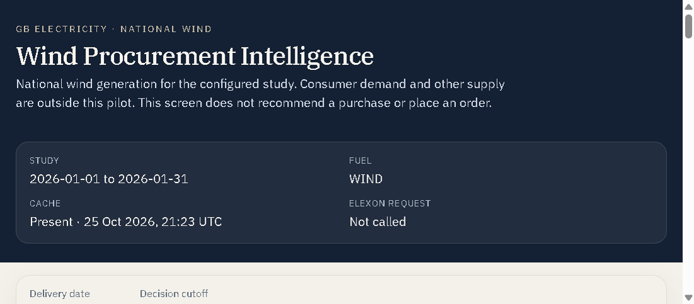
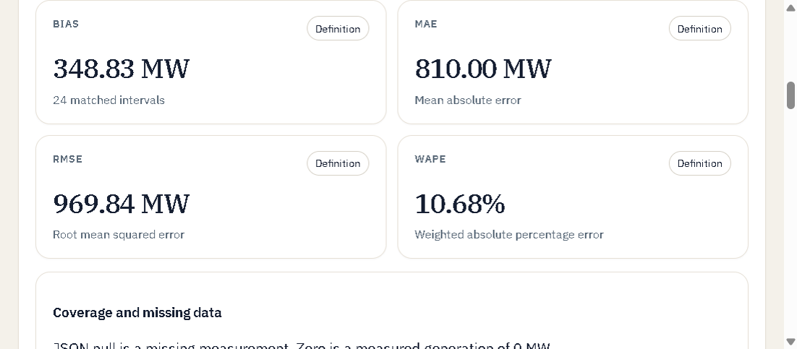
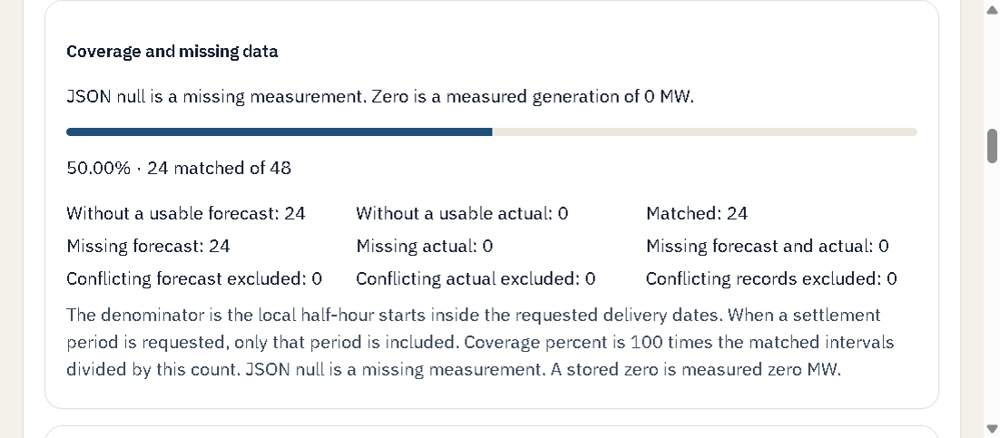
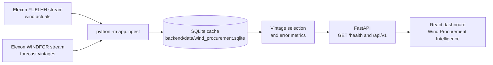

# Wind Procurement Intelligence

A pilot for a GB utility team that buys wind a day ahead. It answers one question: for 1–31 January 2026, how did the national WINDFOR forecast that was already published at a decision cutoff compare with national FUELHH wind generation?

The screen is an analyst dashboard. It does not recommend a purchase and it does not place an order.

## Scope and non-goals

In scope:

- Great Britain, national wind only, fuel type `WIND`.
- Delivery dates 1–31 January 2026, half-hour settlement periods.
- Actuals from the Elexon BMRS FUELHH stream, filtered to wind.
- Forecasts from the Elexon BMRS WINDFOR stream, kept as separate publication vintages.
- A decision-time score: the latest `publishTime` at or before a configurable cutoff.
- MAE, RMSE, bias, WAPE, coverage, and a vintage history.

Out of scope:

- Demand, other fuels, other countries, and any other Elexon dataset.
- Trading rules, prices, orders, or a procurement recommendation. The API field `trading_recommendation` is the literal `not_provided`.
- Treating a forecast published after the cutoff as if the purchaser had it. That comparison exists and is labelled `latest_available` with `available_to_purchaser: false`.
- Filling a missing half-hour by copying or averaging another timestamp.

## View the running application

Local Docker Compose, after the startup steps below:

- Dashboard: http://localhost:8080
- API health: http://localhost:8000/api/health
- API docs: http://localhost:8000/docs

Without Docker, the dashboard is http://localhost:5173 and the API is http://localhost:8000.

The first screen is the overview for the middle study date at the server cutoff. For this extract that date is 16 January 2026 and the cutoff is 09:00 Europe/London.

These screenshots were taken from https://wind-procurement-pilot.vercel.app on 26 October 2026, for 16 January 2026 at the 09:00 Europe/London cutoff. The page was reading the cache fetched at `2026-10-25T21:23:43Z`. Elexon was not called for the page load.





The same response, checked with `GET /api/v1/summary?delivery_date=2026-01-16&decision_cutoff_local=09:00`, returned bias 348.83 MW, MAE 810.00 MW, RMSE 969.84 MW, WAPE 10.68%, 24 matched intervals of 48, selected publication `2026-01-15T07:30:00Z`, and `selections_after_cutoff` 0.



The public site is https://wind-procurement-pilot.vercel.app. The API is on that same origin. Health is https://wind-procurement-pilot.vercel.app/health. See [Deployment](#deployment).

## Architecture

The browser talks only to the read API. Ingestion is a separate command. A dashboard read does not call Elexon.



Docker Compose runs the API in one container and nginx plus the built dashboard in another. nginx proxies `/api`, `/health`, `/openapi.json`, `/docs`, and `/redoc` to the API. The Vite dev server proxies `/api` to `http://localhost:8000`.

## Repository layout

| Path | Role |
| --- | --- |
| `frontend/` | React 19, TypeScript, and Vite. Views, charts, and the typed API client. |
| `frontend/src/api/` | Request paths, response parsers, and guards that reject a leaked post-cutoff score. |
| `frontend/src/views/` | Overview, forecast analysis, forecast history, and data quality. |
| `frontend/Dockerfile` | Production image: Node build, then nginx. |
| `frontend/nginx.conf` | Static files and the API proxy. |
| `backend/app/main.py` | FastAPI application. Production command: `uvicorn app.main:app --host 0.0.0.0 --port 8000`. |
| `backend/app/api/` | Health and `/api/v1` routes, query validation. |
| `backend/app/analytics/` | Cutoff, vintage selection, and MAE, RMSE, bias, WAPE. |
| `backend/app/data_access/` | Elexon client, parsing, deduplication, and SQLite. |
| `backend/app/ingest.py` | `python -m app.ingest` |
| `backend/app/evaluate.py` | `python -m app.evaluate` |
| `backend/tests/` | Pytest. Live Elexon is not required. |
| `backend/data/wind_procurement.sqlite` | Public January 2026 extract fetched at `2026-10-25T21:23:43Z`. |
| `backend/Dockerfile` | Python 3.14 image. Copies that extract into the image. |
| `docker-compose.yml` | Local API on port 8000 and UI on port 8080. |
| `vercel.json` | One Vercel project: Vite frontend and FastAPI backend on the same origin. |
| `.env.example` | Every supported variable, with non-secret defaults. |
| `screenshots/` | The three public-dashboard images above. |

## Local prerequisites

- Docker Desktop, for the Compose path. This machine used Docker server 29.8.2.
- For the non-Docker path: Python 3.14, Node.js 24, and npm. The backend image is `python:3.14-slim`. The frontend image builds with `node:24-alpine`.
- No Elexon API key. The stream calls used here did not require one. Do not put a username or password in `ELEXON_BASE_URL`.

## Docker Compose

From the repository root, with Docker running:

```powershell
docker compose up --build
```

Wait until the backend healthcheck is healthy. Then open http://localhost:8080. The API is http://localhost:8000/api/health.

The Compose file mounts `./backend/data` onto `/app/data`, so a local ingest is visible to the container. The image also contains the January snapshot, for a host that does not mount a volume. `docker compose config` completed with exit code 0 on 26 October 2026.

## Development without Docker

Backend, from `backend`:

```powershell
python -m venv .venv
.\.venv\Scripts\python -m pip install -r requirements-dev.txt
.\.venv\Scripts\python -m uvicorn app.main:app --reload --port 8000
```

`requirements-dev.txt` installs the runtime pins plus Pytest. The production image installs `requirements.txt` only.

Frontend, from `frontend`:

```powershell
npm ci
npm run dev
```

Open http://localhost:5173. Leave `VITE_API_BASE_URL` empty so the dev server proxies `/api` to port 8000.

## Environment variables

Copy the example and change only what you need. `.env` is gitignored.

```powershell
Copy-Item .env.example .env
```

| Variable | Example | Purpose |
| --- | --- | --- |
| `ELEXON_BASE_URL` | `https://data.elexon.co.uk/bmrs/api/v1` | Ingest host. No userinfo. |
| `STUDY_START` | `2026-01-01` | First delivery date. |
| `STUDY_END` | `2026-01-31` | Last delivery date. |
| `FUEL_TYPE` | `WIND` | Only `WIND` is accepted. |
| `DECISION_TIMEZONE` | `Europe/London` | IANA zone for the delivery date and the cutoff. |
| `DECISION_CUTOFF_LOCAL` | `09:00` | Default cutoff clock time, `HH:MM`. |
| `CORS_ALLOWED_ORIGINS` | `http://localhost:5173,http://127.0.0.1:5173,http://localhost:8080,http://127.0.0.1:8080` | Explicit origins. `*` is rejected. |
| `LOG_LEVEL` | `INFO` | Python logging level. Each request is logged with status and duration. |
| `CACHE_PATH` | `data/wind_procurement.sqlite` | Relative paths resolve from the `backend` directory. |
| `VITE_API_BASE_URL` | empty, or `http://localhost:8000` | Browser API origin. Empty means same-origin `/api`. |
| `HTTP_CONNECT_TIMEOUT_SECONDS` | `5` | Ingest connect timeout. |
| `HTTP_READ_TIMEOUT_SECONDS` | `120` | Ingest read timeout. |
| `HTTP_MAX_ATTEMPTS` | `3` | Bounded retries for 429 and 5xx. |
| `HTTP_RETRY_BACKOFF_SECONDS` | `1` | Retry backoff. |
| `FORECAST_PUBLISH_LOOKBACK_DAYS` | `3` | WINDFOR publish window before the study. |
| `FORECAST_PUBLISH_LOOKAHEAD_DAYS` | `3` | WINDFOR publish window after the study. |

There is no API key variable. Do not commit `.env`.

## API

Reads use the SQLite cache. They do not call Elexon. Interactive docs: http://localhost:8000/docs. OpenAPI: http://localhost:8000/openapi.json.

| Method and path | Result |
| --- | --- |
| `GET /health` and `GET /api/health` | Configuration, cutoff basis, and cache presence. No generation values. |
| `GET /api/v1/summary` | Decision-time metrics, plus a separate latest-available block. |
| `GET /api/v1/series` | Each settlement start: actual MW, selected forecast MW, errors, and `publishTime`. |
| `GET /api/v1/accuracy` | The score for the window, each delivery day, and each settlement period. |
| `GET /api/v1/forecast-vintages` | Every cached publication of one target, including publications after the cutoff. |
| `GET /api/v1/data-quality` | Retrieval completeness, separate from the score coverage. |

Query parameters:

- `delivery_date`, or `date_from` and `date_to`. Not both.
- `decision_cutoff_local`, for example `09:00`. This request does not change the server default.
- `settlement_period`, from 1 to 50.
- Vintages take `start_time` or `delivery_date` plus `settlement_period`.

Dates must stay inside the configured study. A request longer than 62 delivery dates is rejected with HTTP 422 and `error_code` `invalid_request`. A missing cache is HTTP 409 `cache_missing`, not an empty series. An unreadable cache is HTTP 503.

Example that was run against the local Compose API on 26 October 2026:

```powershell
Invoke-RestMethod http://127.0.0.1:8080/health
Invoke-RestMethod "http://127.0.0.1:8080/api/v1/summary?delivery_date=2026-01-16&decision_cutoff_local=09:00"
```

Health returned `status` `ok`, `analytics_status` `ready`, `cache_status` `present`, `cache_fetched_at_utc` `2026-10-25T21:23:43Z`, `ingestion_coverage_status` `complete`, and `elexon_request_status` `not_called`.

The summary's primary block returned `available_to_purchaser` true, `selections_after_cutoff` 0, publication `2026-01-15T07:30:00Z`, and these unrounded metrics: mean error 348.8333333333333 MW, MAE 810.0 MW, RMSE 969.842770762354 MW, WAPE 10.68378416997329%. The latest-available block returned `available_to_purchaser` false and `selections_after_cutoff` 24.

JSON null is a missing measurement. A stored 0 is measured zero MW. Units are MW.

## Ingestion and refresh

From `backend`, with the virtual environment activated:

```powershell
.\.venv\Scripts\python -m app.ingest
```

That command calls:

- `GET https://data.elexon.co.uk/bmrs/api/v1/datasets/FUELHH/stream` for the study dates, `fuelType=WIND`.
- `GET https://data.elexon.co.uk/bmrs/api/v1/datasets/WINDFOR/stream` by publish time, from three days before the study through three days after it.

A successful run replaces the SQLite file and prints a coverage report. A failed run leaves the previous successful file in place and does not insert stand-in rows. Identical natural-key copies are stored once and counted. Conflicting values are all stored and counted. They are not averaged.

Dashboard reads do not refresh the cache. After a new ingest, restart is not required for the file contents: the next read sees the new `fetched_at`. On a host with no persistent disk, the file shipped inside the image or the deployment bundle is what survives a restart. Refreshing that copy means running ingest where the file can be written, then building and deploying again.

The checked-in snapshot is the extract fetched at `2026-10-25T21:23:43Z`: 1,488 FUELHH rows and 18,104 WINDFOR rows inside the study, with retrieval coverage `complete`. Pytest does not call Elexon. It uses labelled fixtures.

Score the cache without starting the API:

```powershell
.\.venv\Scripts\python -m app.evaluate
```

## Forecast-vintage selection

For each target `startTime`, the decision-time forecast is the row with the latest `publishTime` that is still at or before the cutoff. A publication at the cutoff is eligible. A publication one second later is not.

The selected `publishTime` is kept even when that row's generation is null or conflicting. A null generation is a missing forecast. It is not zero, and an earlier vintage is not substituted. Conflicting values on that publication are not averaged. An earlier publication does not replace them.

The same rule with no cutoff produces the latest-available comparison. That block can use a publication from after the decision and from after delivery. It is not the purchasing score.

The primary series joins on exact UTC `startTime`. A forecast is not copied onto the next half-hour.

## Metric definitions

Calculated on matched intervals only. An interval is matched when the actual and the selected forecast share a UTC `startTime` and both generations are one integer, including zero. Unmatched intervals are not entered as zero errors.

Signed error is `forecast − actual`, in MW.

| Metric | Definition |
| --- | --- |
| Bias | Mean of the signed errors, in MW. The API field is `mean_error_mw`. |
| MAE | Mean of the absolute errors, in MW. |
| RMSE | Square root of the mean of the squared signed errors, in MW. The divisor is the matched count, not the matched count minus one. |
| WAPE | `100 × sum(absolute error) / sum(actual)`, in percent, only when the sum of matched actuals is greater than zero. Otherwise it is withheld. |
| Coverage | `100 × matched intervals / denominator`. The denominator is the local half-hour starts in the requested delivery dates. A normal day has 48. A requested settlement period limits the denominator to that period. |

MAPE is not calculated. An empty match set returns null error metrics, not zeros.

For the full January window at the default cutoff, the cache records 744 matched intervals of 1,488, bias 1,851.53 MW, MAE 2,127.48 MW, RMSE 2,606.07 MW, and WAPE 18.37%. Those figures are from the 25 October cache. The 744 gaps are the `:30` periods, which have an actual and no WINDFOR timestamp.

## Timezone, cutoff, and historical data

The delivery date is the Europe/London calendar date of the interval start. FUELHH `settlementDate` is that date. WINDFOR has no settlement date, so its delivery date is the local date of `startTime`.

The cutoff is `DECISION_CUTOFF_LOCAL` on the previous calendar day in `DECISION_TIMEZONE`, converted to UTC. The default 09:00 is a pilot assumption. It is not an EPEX auction gate, BSC Gate Closure, or the BSC Submission Deadline. `cutoff_basis` stays `pilot_assumption` when the clock time changes.

January 2026 in Europe/London is GMT, so 09:00 local is 09:00Z. The conversion still runs. On a British Summer Time date, 09:00 Europe/London is 08:00Z. The 1 January cutoff is `2025-12-31T09:00:00Z`. The 31 January cutoff is `2026-01-30T09:00:00Z`.

The grid is walked in UTC. A spring-forward day has 46 half-hours and a fall-back day has 50. January 2026 has neither, so the month has 1,488 starts.

Naive timestamps are rejected. Stored instants are UTC. The historical rows in the snapshot are whatever those two streams returned on 25 October 2026 for the windows above. A later Elexon revision is not in this file until ingest is run again.

## Tests

Commands run on 26 October 2026:

```text
backend> .\.venv\Scripts\python -m pytest -q
....................................................                     [100%]
52 passed in 6.57s

frontend> npm test
Test Files  1 passed (1)
     Tests  6 passed (6)

frontend> npm run build
dist/index.html                            0.74 kB │ gzip:   0.40 kB
dist/assets/index-BbL4OOlw.css             7.31 kB │ gzip:   2.31 kB
dist/assets/AnalysisView-DWXWVC9D.js       5.14 kB │ gzip:   1.86 kB
dist/assets/OverviewView-DrFHZaxY.js       8.20 kB │ gzip:   2.48 kB
dist/assets/HistoryView-DKkLSd4_.js       15.77 kB │ gzip:   4.84 kB
dist/assets/SettlementTable-YRMMhQ_l.js   27.41 kB │ gzip:   8.87 kB
dist/assets/index-BAWumFzi.js            256.52 kB │ gzip:  78.47 kB
dist/assets/LineChart-DwI7heVQ.js        353.94 kB │ gzip: 102.99 kB
✓ built in 640ms
```

There is no ESLint configuration, so no lint command was run. Pytest covers cutoff equality, a publication one second late, missing and duplicate rows, London timezone and clock-change denominators, a hand-calculated MAE/RMSE/bias/WAPE example, API validation, a simulated upstream failure, a missing cache, and an empty dataset. The frontend tests cover query construction, a reversed date range, a leaked post-cutoff flag, a measured zero beside a missing forecast, and an HTTP 409 message that is not reported as `0 MW`.

`npm run build` is the production frontend build: `tsc --noEmit` and then Vite.

## Deployment

Local production shape:

- Frontend image: `npm run build`, then nginx serving `dist`.
- Backend image: `uvicorn app.main:app --host 0.0.0.0 --port 8000`.
- Configuration is environment variables. CORS origins are explicit. The startup log records the study window, the cutoff, and that Elexon was not called. Each request logs method, path, status, and duration.

Public hosting is the Vercel Hobby team **HESOYAM** (`https://vercel.com/HESO-YAM`). The project is `wind-procurement-pilot` under that team. The CLI scope is `heso-yam`; `HESO-YAM` is rejected by the CLI. The app uses Vercel's FastAPI and Vite support (`vercel.json`). The frontend and API share an origin, so the browser calls relative `/api` and `/health`. Vercel documents Python 3.12, 3.13, and 3.14 on Functions. The Hobby plan includes a free allowance and is restricted to non-commercial personal use. Functions are not an always-on process. The filesystem does not keep writes across invocations, so the January SQLite file travels inside the deployment. Render's free web service was the alternative: it also has an ephemeral disk, sleeps after 15 minutes without traffic, and persistent disks are paid.

The first production deploy on 26 October 2026 built, then `GET /health` returned HTTP 500 `FUNCTION_INVOCATION_FAILED`. The runtime log said `No module named 'fastapi'` because Vercel installed the empty dependency list in `pyproject.toml` and did not install `requirements.txt`. The pins were copied into `pyproject.toml` and the project was deployed again.

Verified on 26 October 2026, without a Vercel session cookie:

- Frontend: https://wind-procurement-pilot.vercel.app returned the dashboard HTML, HTTP 200.
- Backend: same origin. `GET /api/v1/summary?delivery_date=2026-01-16&decision_cutoff_local=09:00` returned MAE 810.0 MW, 24 matched intervals, publication `2026-01-15T07:30:00Z`, `selections_after_cutoff` 0, and `live_elexon_request` false.
- Health: https://wind-procurement-pilot.vercel.app/health returned HTTP 200, `analytics_status` `ready`, `cache_status` `present`, `cache_fetched_at_utc` `2026-10-25T21:23:43Z`, `elexon_request_status` `not_called`.

The browser loaded that origin and showed bias 348.83 MW, MAE 810.00 MW, RMSE 969.84 MW, and the same publication. Requests to `/api/health`, `/api/v1/summary`, `/api/v1/series`, and `/api/v1/accuracy` all returned HTTP 200. No failed resource requests and no Vite error overlay were observed.

The redesigned dashboard was deployed again later on 26 October 2026. Anonymous `GET /health` still returned HTTP 200 with `cache_fetched_at_utc` `2026-10-25T21:23:43Z` and `elexon_request_status` `not_called`. The same 16 January summary still returned MAE 810.0 MW, 24 matched intervals, publication `2026-01-15T07:30:00Z`, and `selections_after_cutoff` 0. That deployment is `dpl_B1cqtnXCran1EqWFBDzP7YqAyCNC` (https://vercel.com/heso-yam/wind-procurement-pilot/B1cqtnXCran1EqWFBDzP7YqAyCNC). The screenshots above are from that deployment.

To redeploy from the repository root after `npx vercel login`:

```powershell
npx vercel deploy --yes --prod --scope heso-yam --project wind-procurement-pilot
```

Same-origin `/api` calls do not need a CORS change. Set `CORS_ALLOWED_ORIGINS` to the public origin before calling the API from a different host.

## Known limitations and next steps

- The public site is on the Vercel Hobby plan. It is not always-on, and a cold start can delay the first request. Do not add a payment method for this pilot. A writable disk is not available, so a data refresh still requires a new deploy of the SQLite file.
- The default cutoff is a pilot assumption.
- WINDFOR in this extract is hourly. Half-hour actuals at `:30` stay missing. Coverage near 50% on a full day is that gap, while retrieval coverage is `complete`.
- The hour-average sensitivity is not calculated.
- The overview still downloads the Recharts chart chunk (`LineChart-DwI7heVQ.js`, 353.94 kB) with the entry chunk (`index-BAWumFzi.js`, 256.52 kB). Forecast analysis, forecast history, and the settlement table are separate files.
- The cache is a snapshot from 25 October 2026. It will not pick up a later Elexon correction until ingest is run and the file is redeployed.
- A demo video has not been recorded.
- The configured Git remote is `https://github.com/AyushAgrwl21/HESOYAM.git`. Local and GitHub `main` are `999a2a3`, message `Final Changes`, on top of `Ready for submission`. The Vercel project was uploaded with the CLI, not by a GitHub integration.

## AI-tool disclosure

An AI coding assistant in Cursor was used for implementation, test execution, browser checks, and documentation, including this README. The assistant in this session is Grok. The repository should not be read as entirely human-written.

## Data attribution

Contains BMRS data © Elexon Limited copyright and database right 2026.

This pilot is not endorsed by Elexon.

- [BMRS open-data licence](https://www.elexon.co.uk/bsc/data/balancing-mechanism-reporting-agent/copyright-licence-bmrs-data/)
- [BMRS API licence](https://www.elexon.co.uk/bsc/data/balancing-mechanism-reporting-agent/copyright-licence-use-bmrs-api/)
- [FUELHH stream](https://bmrs.elexon.co.uk/api-documentation/endpoint/datasets/FUELHH/stream)
- [WINDFOR stream](https://bmrs.elexon.co.uk/api-documentation/endpoint/datasets/WINDFOR/stream)
- [Insights developer portal](https://developer.data.elexon.co.uk/)
- [API guidance](https://bmrs.elexon.co.uk/api-documentation/guidance)
